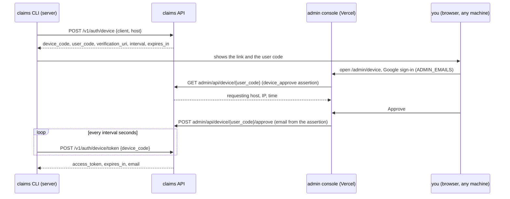

# CLI login (device code)

> **Status (2026-11-24): built.** `claims login`, `claims whoami` and `claims logout` work against QA, and
> the admin console approves sign-ins at `/admin/device` and lists them under Keys, CLI sessions.
> `claims release publish ... --api qa` uses the token to publish a release into the deployed service
> ([Publishing to a deployed service](publishing-to-a-deployment.md)).

Publishing a collection to a shared deployment must say who did it, and not everyone may do it. The
`claims` CLI often runs on a remote server, sometimes driven by an agent, where no browser is
available. So it signs in with a **device code**, the flow of [RFC 8628](https://www.rfc-editor.org/rfc/rfc8628):
the CLI shows a link and a short code, a person approves it in a browser on any machine, and the CLI
receives a token.

## Decisions

| Question | Decision (2026-11-24, Chase) |
| --- | --- |
| Who may approve a login and publish | The console's admins: the `ADMIN_EMAILS` list on Vercel, the one list of admins. No second list. |
| Which collections a login may publish | Any. Every release records who published it. Per-collection grants come later, when there are publishers outside the core team; the schema leaves room for them. |
| Where approval happens | The admin console (`/admin/device`), behind its existing Google sign-in. |
| What the token is | An opaque random token whose SHA-256 alone is stored, like deposit keys, so it can be listed and revoked. Not a JWT. |
| Token lifetime | 30 days, then `claims login` again. Revocable at any time from the console or with `claims logout`. |

## The flow

```text
server$ claims login --api https://api-qa.hugeampkpnbi.org/api/claims
  To sign in, open  https://claims-repository.vercel.app/admin/device
  and enter         WDJB-MJHT
  Requested from pigean-runner (203.0.113.7). The code expires in 10 minutes.
  waiting...
  Signed in as someone@broadinstitute.org. The token expires 2026-12-24.
```



## API

### Public routes

**`POST /v1/auth/device`** starts a login. The body is `{"client": "claims-cli/<version>", "host": "<hostname>"}`.

```json
{"device_code": "<43 url-safe characters>", "user_code": "WDJB-MJHT",
 "verification_uri": "https://claims-repository.vercel.app/admin/device",
 "verification_uri_complete": "https://claims-repository.vercel.app/admin/device?code=WDJB-MJHT",
 "expires_in": 600, "interval": 5}
```

**`POST /v1/auth/device/token`** is polled by the CLI with `{"device_code": "..."}`. Until the login is
decided it answers `400 {"error": "authorization_pending"}`. Polling faster than `interval` answers
`slow_down`, and the CLI adds 5 seconds to its interval. The other terminal errors are
`access_denied` and `expired_token`. On approval it answers once:

```json
{"access_token": "clp_<43 url-safe characters>", "token_type": "Bearer",
 "expires_in": 2592000, "email": "someone@broadinstitute.org", "token_id": "tok_<16 hex>"}
```

The device code is then consumed. Polling it again answers `expired_token`.

**`GET /v1/auth/whoami`** (Bearer token) answers `{email, token_id, expires_at}`, or 401.

**`POST /v1/auth/logout`** (Bearer token) revokes that token.

### Console-only routes

These are under `/v1/admin/api`, called only by the console's server with an HS256 assertion of a
new purpose, **`device_approve`**. It carries the approver's Google-verified email, like
`admin_write`. A separate purpose means a leaked read or write assertion cannot approve a login.

- `GET device/{user_code}`: the pending request's host, IP, client and time, or 404 for an unknown,
  expired or decided code.
- `POST device/{user_code}/approve` and `POST device/{user_code}/deny`.

Token management rides on the existing `admin_read` and `admin_write` purposes:

- `GET tokens`: id, email, host, created, expires, last used and state, never a token or a hash.
- `POST tokens/{token_id}/revoke`.

### Publisher dependency

`require_publisher(request)` reads `Authorization: Bearer clp_...`, looks up its SHA-256, refuses
an expired or revoked token with one 401 answer, updates `last_used_at`, and returns
`{email, token_id}`. Publish routes (the second half) depend on it and record `published_by` and
`token_id` on the release.

## Data (migration `010_device_login.sql`)

```sql
CREATE TABLE device_codes (
  device_code_sha256 CHAR(64) PRIMARY KEY,
  user_code CHAR(8) NOT NULL UNIQUE,         -- stored without the dash
  status VARCHAR(16) NOT NULL,              -- pending | approved | denied | consumed
  client VARCHAR(64), host VARCHAR(255), ip VARCHAR(64),
  requested_at DATETIME NOT NULL, expires_at DATETIME NOT NULL, last_polled_at DATETIME NULL,
  decided_by VARCHAR(320) NULL, decided_at DATETIME NULL,
  token_id VARCHAR(32) NULL                 -- set when the approved code is exchanged
);

CREATE TABLE publisher_tokens (
  token_id VARCHAR(32) PRIMARY KEY,         -- tok_<16 hex>, public
  token_sha256 CHAR(64) NOT NULL UNIQUE,
  email VARCHAR(320) NOT NULL,
  host VARCHAR(255) NULL,
  created_at DATETIME NOT NULL, expires_at DATETIME NOT NULL, last_used_at DATETIME NULL,
  revoked_at DATETIME NULL, revoked_by VARCHAR(320) NULL
);
```

The MySQL migration uses the repository's conventions (ascii_bin keys, utf8mb4). `service/db.py` creates
the same tables in SQLite. A later `publisher_grants(email, collection_key)` table adds per-collection
scope without changing these tables.

Audit rows go in `admin_auth_events`: `device_login_requested`, `device_login_approved`,
`device_login_denied`, `publisher_token_issued`, `publisher_token_revoked`. Each records the email and
the host.

## Console

- **`/admin/device`**: signed-in admins only. It takes the code (prefilled from `?code=`), then shows
  the requesting host, IP, client and time, with **Approve** and **Deny** and the warning: *Only approve
  a code you started yourself.*
- **Keys page**: a **CLI sessions** table (email, host, created, last used, expires) with **Revoke**.
- **`policy.ts`**: adds the `device/...` and `tokens...` paths to the proxy, plus a `device_approve`
  assertion sent only from the device page's server action.

## CLI

| Command | What it does |
| --- | --- |
| `claims login [--api URL]` | Starts a login, prints the link and code, polls, and saves the token. |
| `claims login --no-wait` / `claims login --continue` | Prints the code and returns at once, saving the pending device code; `--continue` polls and finishes. Use it when an agent's command would time out before you approve. |
| `claims whoami` | The signed-in email and the token's expiry, checked against the API. |
| `claims logout` | Revokes the token on the server and removes it locally. |

The default `--api` is `$CLAIMS_API` or QA. Credentials are stored in
`~/.config/claims/credentials.json` with mode `0600`, keyed by API base URL. `CLAIMS_TOKEN` overrides
the file, for unattended runs. The CLI never prints a token.

## Security

- **Codes.** The user code is 8 characters from 20 consonants (`BCDFGHJKLMNPQRSTVWXZ`): about 2.6 × 10¹⁰
  values, no words, case-insensitive, with the dash ignored. A code expires after 10 minutes and works
  once. The API keeps at most 5 pending codes per IP. Guessing a code needs a signed-in admin, because
  only the console can look one up.
- **Secrets.** The device code and the token are 32 random bytes each (`secrets.token_urlsafe`). Only
  their SHA-256 is stored, and comparisons are constant time. The `clp_` prefix keeps publisher tokens
  distinct from `clm_` deposit keys and easy for secret scanners to find.
- **Phishing.** Someone could send an admin a code they started themselves. The approval page shows the
  requesting host and IP, the warning above is on the page, and every approval is audited.
- **One identity.** The approver's email comes from the signed assertion, never from the request body.
- **QA and prod share one database**, so a token works on both, as deposit keys do.

## Tests

- **API (pytest, SQLite):** each RFC 8628 state (pending, slow_down, approved once, denied, expired,
  consumed); a purpose other than `device_approve` cannot approve; expired and revoked tokens are refused
  with the same 401; `whoami` and `logout`; the pending-code cap per IP; audit rows.
- **Console (vitest):** the policy allows the new paths and no others.
- **CLI:** login against an in-process API with a test approver; `--no-wait` and `--continue`; the
  credentials file mode; `CLAIMS_TOKEN`.
- **End to end:** `claims login` from a remote server against QA, approved in the console, then
  `claims whoami`.

## Using it

```bash
./bin/claims login                 # prints a link and a code; approve it in the console
./bin/claims login --no-wait       # for an agent: print the link and code, return at once ...
./bin/claims login --continue      # ... then finish after you approve
./bin/claims whoami
./bin/claims logout
```

`--api` defaults to `$CLAIMS_API`, else QA (`https://api-qa.hugeampkpnbi.org/api/claims`).

## Rollout

1. API routes, migration `010`, and tests, in this repository.
2. The console page, Keys table and policy, then a Vercel deploy. Add `CLAIMS_DEVICE_VERIFICATION_URL`
   to the API's environment.
3. The CLI commands.
4. Sync into `dig-service-platform` (`claims/`), run `scripts/migrate.py` on Aurora, and deploy QA.
5. From the server: `claims login`, approve, `claims whoami`.

## Not in this step

- The publish endpoint, which moves a collection built in the CLI's local DuckDB deployment into the
  deployed store, recording `published_by`.
- Per-collection grants (`publisher_grants`).
- Tokens for machines with no person behind them. Today that is deposit keys.
