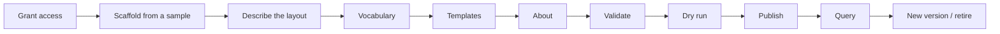

# Creating a collection

> **Status (2026-11-17): partly built.** A local version of the `claims` CLI and a Parquet result
> store exist in this repository (`bin/claims`); the commands marked *planned* below do not exist yet.
> [What exists today](#what-exists-today) says which is which. The worked example uses the real
> PIGEAN run that was published on QA as the `pigean` collection, and the numbers are that run's.
> Background: [collections.md](collections.md), and the design study *Querying PIGEAN results where
> they sit*.

A **collection** turns a method's result files into DAPPER claims that people can query. Your files stay
where they are. The repository reads them once per release, keeps a small index of what it needs, and
pins the exact version of each file it read. Every claim it serves can then be checked against your
original bytes.

You provide four things, plus read access:

| You provide | What it is | PIGEAN example |
| --- | --- | --- |
| **1. Data layout** | Where the files are, how they are named, and what a row in each file means | `s3://dig-pigean-paper-regression-2/out/falcon/{kind}/{library}/portal/{trait}/{kind}.json` |
| **2. Templates** | How a row becomes claims, and the queries people run | measurement, evidence-tier and roster claims; `top-genes-with-sets` |
| **3. Vocabulary** | What each value means: identifiers, metric meanings, relations | genes are `HGNC.SYMBOL`, traits map to `KPN.TRAIT` ids through the collection's own `mappings/trait.tsv`, `combined` is log posterior odds |
| **4. About** | Who stands behind the claims and how the results were produced | owners, attributed agent, PIGEAN version and parameters, license |
| **Access** | Lasting read access to the files for the repository's role | a bucket-policy statement |

The repository works out everything else: the file list, sizes, sha256 hashes, version pins, the dataset
list, the index, every id, and the dry-run report.



---

## Step 0. Install the CLI and sign in

```bash
pip install claims-repository-cli
```

```bash
claims login --api https://api-qa.hugeampkpnbi.org/api/claims
```

`claims login` stores your publisher key, which an admin issues in the admin console's **Keys** page.
Reading never needs a key; publishing always does.

---

## Step 1. Give the repository read access

The repository reads your files when it publishes a release and when it verifies them later. It never
writes to your storage.

**S3.** Add this statement to the bucket policy. The role ARN is shown on the admin console's
**Sources** page.

```json
{
  "Sid": "ClaimsRepositoryRead",
  "Effect": "Allow",
  "Principal": { "AWS": "arn:aws:iam::<claims-account>:role/claims-repository-reader" },
  "Action": ["s3:GetObject", "s3:GetObjectVersion", "s3:ListBucket", "s3:GetBucketVersioning"],
  "Resource": [
    "arn:aws:s3:::dig-pigean-paper-regression-2",
    "arn:aws:s3:::dig-pigean-paper-regression-2/out/falcon/*"
  ]
}
```

**Turn on versioning.** Every measurement claim cites a byte range of a file and that file's sha256.
With versioning on, the repository pins each file's version id, so the exact bytes stay findable even
after you overwrite the file. Without it, the repository can only notice that a file changed.

```bash
aws s3api put-bucket-versioning --bucket dig-pigean-paper-regression-2 --versioning-configuration Status=Enabled
```

Do not add a lifecycle rule that expires versions a published release cites.

**Check access before anything else:**

```bash
claims sources check s3://dig-pigean-paper-regression-2/out/falcon/
```

```text
source   s3://dig-pigean-paper-regression-2/out/falcon/   (us-east-1)
read     ok      list and get as claims-repository-reader
objects  4,332 result files of three kinds, 24.4 GB
version  OFF     files can only be watched for change, not pinned.
                 Turn versioning on to pin them:
                 aws s3api put-bucket-versioning --bucket dig-pigean-paper-regression-2 ...
```

Versioning really was off for the PIGEAN bucket on 2026-11-17.

Other sources work the same way:

- **GCS:** grant `roles/storage.objectViewer` to the repository's service account. The pin is the
  object's generation number.
- **HTTPS:** a URL list. The pin is sha256, size and ETag, so changes are detected but not prevented.
- **Croissant, DOI or DRS record:** the record is resolved to a file list (see
  [collections.md §4](collections.md#4-bringing-data)).

---

## Step 2. Scaffold the collection from a sample

Point the CLI at one example of each kind of file, and name the columns that hold the dataset dimensions.
It reads the start of each file (8 MB by default), works out the path pattern, what a row is, the
identifiers and the metrics, and writes a draft for you to finish.

```bash
claims collection init pigean --handle pigean --method PIGEAN \
  --title "PIGEAN gene and gene-set associations" \
  --source s3://dig-pigean-paper-regression-2/out/falcon/ \
  --sample gene_stats=combined_gene_stats/mouse_msigdb/portal/IBD/combined_gene_stats.json \
  --sample gene_set_stats=combined_gene_set_stats/mouse_msigdb/portal/IBD/combined_gene_set_stats.json \
  --sample membership=gene_gene_set_stats/mouse_msigdb/portal/IBD/gene_gene_set_stats.json \
  --dimension trait=phenotype --dimension library=gene_set_size
```

```text
combined_gene_stats/mouse_msigdb/portal/IBD/combined_gene_stats.json     ndjson   18,575 rows sampled of 3.5 MB   12 columns
combined_gene_set_stats/mouse_msigdb/portal/IBD/combined_gene_set_stats.json ndjson    1,441 rows sampled of 408.7 KB   11 columns
gene_gene_set_stats/mouse_msigdb/portal/IBD/gene_gene_set_stats.json     ndjson   28,760 rows sampled of 74.5 MB   12 columns
pattern      s3://dig-pigean-paper-regression-2/out/falcon/{kind}/{library}/portal/{trait}/{kind}.json
dimensions   library (from column gene_set_size), trait (from column phenotype)
row kind     gene_trait: Gene (gene) -> Trait; metrics prior, combined, huge_score, log_bf, n, sigma
row kind     gene_set_trait: GeneSet (gene_set) -> Trait; metrics beta, beta_uncorrected, n, sigma
edge kind    member_of: Gene -> GeneSet
wrote        pigean/ (collection.yaml, source.yaml, 3 templates, 1 query, GUIDE.md)
next         read pigean/GUIDE.md, finish the TODOs, then: claims collection validate pigean
```

What it worked out, and how:

- **Path pattern.** The file's own name is `{kind}`; a path segment equal to a dimension column's value
  (`IBD` in `phenotype`) becomes that dimension. Without `--dimension`, columns whose single value appears
  in the path are used.
- **Rows and edges.** A file with a column that is unique on every row is a row kind, keyed by that column.
  A file where only a pair of columns is unique is an edge kind (here, gene `member_of` gene set). When an
  edge's end is another file's subject, that end becomes a minted gene set with a roster.
- **Identifiers.** Known column names get their vocabulary (`gene` → `HGNC.SYMBOL`); others get
  `TODO:{value}`. A dimension named like a trait gets the collection's own vocabulary files,
  `mappings/trait.tsv` and `mappings/trait.sssom.tsv`, started from the sampled keys and a KPN trait release
  file (`--traits`, default the kpn-data-models v0.0.2 release). The service reads no registry.
- **Metrics.** Every numeric column present on every row. Remove the ones that are not results (here `n`
  and `sigma`, and probably `huge_score`).

```text
pigean/
  GUIDE.md               # the checklist of what is left to fill in, and what the samples showed
  collection.yaml        # pieces 1, 3 and 4: meaning of the files, vocabulary, about
  source.yaml            # where the files are, how they are named, provenance
  templates/             # piece 2: generated claim templates
  queries/               # one generated query
  provenance/            # DAPPER provenance documents kept with the collection
  releases/              # one file per planned release
```

Every value the files could not tell it is a `TODO`. `claims collection validate` lists the ones left, and
`claims release publish` refuses a collection with any left (`--allow-draft` overrides that for a test
deployment). Keep this directory in git: review of a change to it is the governance step.

---

## Step 3. Describe the data layout (piece 1)

The layout lives in two places, split by whether it affects claim ids:

- **`collection.yaml`** says what each kind of file *means*: its format, which row kind or edge kind it
  yields, and which columns name the dataset. This is part of the manifest's minting section, so changing
  it re-addresses claims.
- **`source.yaml`** says where the files *are* and how they are named. Moving files, or pointing at a
  copy, changes no claim id.

```yaml
# source.yaml
location: s3://dig-pigean-paper-regression-2/out/falcon/
path: "{kind}/{library}/portal/{trait}/{kind}.json"   # each distinct (library, trait) is one dataset
roles:
  gene_stats:     {kind: combined_gene_stats}
  gene_set_stats: {kind: combined_gene_set_stats, optional: true}    # 16 PIGEAN traits have an empty file
  membership:     {kind: gene_gene_set_stats, requires: gene_set_stats}  # no gene sets, no roster
run: "PIGEAN run recorded under s3://dig-pigean-paper-regression-2/out/falcon (gene-set library mouse_msigdb, ...)."
where:                                   # default row bounds; `--where` on the command line overrides
  gene_phenotype: {combined: {gt: 0.5}}
  gene_set_phenotype: {beta_uncorrected: {gt: 0.01}}
```

```yaml
# collection.yaml
collection: pigean                       # the handle: the collection's identity, used in every URL
title: PIGEAN gene and gene-set associations

dataset_dimensions:                      # must match the placeholders in source.yaml's path (besides {kind})
  - name: trait                          # IBD -> KPN.TRAIT:0000505, through mappings/trait.tsv
  - name: library

mappings:                                # the collection's own vocabulary: key, id, label per row
  trait: mappings/trait.tsv
unmapped:
  trait: keep-raw                        # a key the file does not map is kept as given

file_roles:
  gene_stats:
    format: ndjson
    media_type: application/x-ndjson
    yields: gene_phenotype
    dimension_columns: {trait: phenotype, library: gene_set_size}   # cross-checked against the path
  gene_set_stats:
    format: ndjson
    media_type: application/x-ndjson
    yields: gene_set_phenotype
    dimension_columns: {trait: phenotype, library: gene_set_size}
  membership:
    format: ndjson
    media_type: application/x-ndjson
    yields: member_of
    dimension_columns: {trait: phenotype, library: gene_set_size}

row_kinds:
  gene_phenotype:
    subject: {entity: Gene, column: gene}
    object: {entity: Trait}              # the trait comes from the dataset, not a column
    metrics: [combined, log_bf, prior]
    keep: [trait_group]                  # extra columns carried into query results
  gene_set_phenotype:
    subject: {entity: GeneSet, column: gene_set}
    object: {entity: Trait}
    metrics: [beta, beta_uncorrected]
    keep: [trait_group, source]

edge_kinds:
  member_of:
    from: {entity: Gene, column: gene}
    to: {entity: GeneSet, column: gene_set}
```

Edge files (here, membership) are read with a bare Python `None` treated as `null`, because some aggregator
runs write missing values that way. Only the two ends of each edge are kept from those files. Row files must
be valid JSON.

Rules the repository enforces:

- **One row per subject per file.** A gene appears at most once in a trait's `combined_gene_stats.json`.
- **Metrics are numbers.** A value that is missing, `NaN` or infinite is refused, with its file and line.
- **Rows outside the dataset are refused.** A file whose `phenotype` column disagrees with `{trait}` in
  its path is refused, which catches a file filed under the wrong trait.

---

## Step 4. Write the vocabulary (piece 3)

The vocabulary says what each value means, so every claim states it in identifiers others can resolve.

```yaml
# collection.yaml (continued)
prefixes:
  HGNC.SYMBOL: "https://identifiers.org/hgnc.symbol:"
  KPN.TRAIT: "https://broadinstitute.github.io/kpn-data-models/kpn.trait/"
  biolink: "https://w3id.org/biolink/vocab/"

entities:
  Gene:
    id: "HGNC.SYMBOL:{value}"            # values are taken as the files give them
  GeneSet:
    mint: GeneSet                        # a DAPPER GeneSet per set, with its full roster
    members_from: member_of
    library_dimension: library
  Trait:
    dimension: trait

relations:
  associated_with: biolink:associated_with
  genetically_associated_with: biolink:genetically_associated_with
  relevant_to: urn:kpn:relation:relevant_to
  functionally_relevant_to: urn:kpn:relation:functionally_relevant_to
  has_members: urn:kpn:relation:has_members

metrics:
  combined:
    score_kind: SCORE
    scale: log posterior odds
    better: higher
    interpretation: >-
      PIGEAN combined log posterior odds of gene-phenotype association (direct GWAS plus
      gene-set prior evidence); log scale, larger is stronger.
  log_bf:   { score_kind: SCORE, scale: log Bayes factor, better: higher, interpretation: "..." }
  prior:    { score_kind: SCORE, scale: log prior odds, better: higher, interpretation: "..." }
  beta:     { score_kind: EFFECT_ESTIMATE, scale: log-odds effect, better: higher, interpretation: "..." }
  beta_uncorrected: { score_kind: EFFECT_ESTIMATE, scale: log-odds effect, better: higher, interpretation: "..." }

mappings:
  trait: mappings/trait.tsv              # the collection's own vocabulary: key, id, label, category, ...
xrefs:
  trait: mappings/trait.sssom.tsv        # the ids' cross-references to EFO, MONDO, MESH, ... (SSSOM columns)
unmapped:
  trait: keep-raw                        # or: refuse (publishing fails), skip (the dataset is left out)
```

Each metric's interpretation is copied into every score the collection mints, so write it as you would
in a methods section. Only you know what your numbers mean.

### Check the vocabulary against your data

```bash
claims vocab check pigean
```

```text
checked      1,444 datasets from s3://dig-pigean-paper-regression-2/out/falcon/{kind}/{library}/portal/{trait}/{kind}.json
traits       kpn-data-models trait release v0.0.2 (~/src/research/portal-data-models/versions/trait/v0.0.2/...)
trait        1,444 values: 1,150 through the collection's mapping, 294 unmapped (unmapped: keep-raw)
             2hrCPEP -> KPN.TRAIT:0000318  Two-hour (2hr) C-peptide
             2hrG -> KPN.TRAIT:0000319  Two-hour (2hr) glucose
             closest release trait for each (a hint, never applied): 29 exact name, 32 close (>= 0.7), 233 weak or none
             Alopecia                                     1.00  KPN.TRAIT:0001760  alopecia
             Autism                                       1.00  KPN.TRAIT:0000811  Autism
             Depression                                   1.00  KPN.TRAIT:0001173  Depression
             ... and 282 more (--show N)
entities     from 2 dataset(s), the first 2.0 MB of each file
  Gene       gene         9,481 distinct  as HGNC.SYMBOL:{value}   e.g. HGNC.SYMBOL:A1BG
             ok
  GeneSet    gene_set     203 distinct  as minted GeneSet   e.g. ANDERSON_BLOOD_CN54GP140_ADJUVANTED_WITH_GLA_AF_AGE_18_45YO_3DY_UP
             ok
```

It reads only the file listing for dimension values, plus the start of a few files for entity values
(`--sample-datasets`, `--sample-bytes`). Entity values are flagged when they are empty, padded, not ASCII,
longer than 255 characters as an id, or do not look like their vocabulary (an `HGNC.SYMBOL` with a space).

The suggestions match each key's words against the release's trait names and keys. They are hints: a wrong
mapping makes every claim of that dataset name the wrong trait, so nothing is mapped unless you write it.

### Map what you can

```bash
claims vocab check pigean --write-template --fill-from-suggestions 0.99
```

This writes every key into `mappings/trait.tsv`. A key the release names exactly (as a legacy, PIGEAN or
`KPN.TRAIT` key) gets its id, label, category, type and primary concept; any other key gets the best
suggestion in columns publishing ignores. Rows already in the file keep their id and label. It also writes
the mapped ids' cross-references to `mappings/trait.sssom.tsv`, and adds the `mappings` and `xrefs` entries
to the manifest. `--fill-from-suggestions 0.99` also copies exact-name suggestions into the `id` column,
for you to review:

```text
key	id	label	category	trait_type	concept_id	concept_label	suggested_id	suggested_name	score
Autism	KPN.TRAIT:0000811						KPN.TRAIT:0000811	Autism	1.0
Migraine	KPN.TRAIT:0003851						KPN.TRAIT:0003851	migraine disorder	0.58
ADFather									KPN.TRAIT:0000032	Parental longevity (father's age at death)	0.28
```

Here a person kept `Autism`, mapped `Migraine` by hand to "migraine disorder", and left `ADFather` empty,
because the suggestion is wrong. A row with an empty `id` stays unmapped. Run `--write-template` again to
fill the label, attributes and cross-references of the ids you added; a label left empty is the key.

These two files are the collection's whole trait vocabulary. `dimensionValues` (GraphQL) and
`GET /v1/collections/{c}/dimensions/trait` serve them: each value's label, accepted keys, attributes
and cross-references.

A mapping changes the dataset's trait value, and so the ids of that dataset's claims, as it should: the
claims now name the right trait. Queries accept the original key as well (`trait=Migraine` finds
`KPN.TRAIT:0003851`), because each release records the mappings it used. Every release lists the mapping
file it read, with its sha256.

---

## Step 5. Write the templates (piece 2)

`collection init` already wrote default templates. To regenerate them after editing the manifest:

```bash
claims templates generate pigean
```

```text
wrote        templates/gene_set_trait.yaml   for gene_set_trait   claims: measurement
wrote        templates/gene_trait.yaml   for gene_trait   claims: measurement
wrote        templates/member_of-roster.yaml   for member_of   claims: roster
```

It writes one measurement claim per row kind and one roster claim per edge kind that defines a minted
set, adds them to the manifest's `templates:` list, and never overwrites a file you have edited unless you
pass `--force`. Edit the wording freely. To add evidence tiers, add a rule and a claim that uses it, as
below.

A **measurement claim** reports a row's scores as they are, with evidence that points at the exact bytes
of each value:

```yaml
# templates/gene.yaml
template: gene
version: 1.0.0
for: gene_phenotype
claims:
  - key: measurement
    proposition:
      statement: "The gene {subject.label} is associated with {object.label}."
      subject: "{subject.id}"
      relation: associated_with
      object: "{object.id}"
      kind: RESULT
    statement: >-
      PIGEAN assessed the association of {subject.label} with {object.label}
      (combined {metric.combined.text}; log BF {metric.log_bf.text}; prior {metric.prior.text})
      over the {dataset.library} gene-set library.
    scores: [combined, log_bf, prior]
    evidence:
      per_metric: [combined, log_bf, prior]   # one ValueLocator per value: file, byte range, exact text
      explanation: >-
        PIGEAN reported {metric.name} = {metric.text} for this association in {file.name}.
    source_locator: "{file.name}#gene={subject.label}"
```

An **evidence-tier claim** classifies one score under a declared rule. Thresholds are never implicit:
they are a versioned rule in the manifest, and the rule's name and version appear in the evidence.

```yaml
# collection.yaml
tier_rules:
  gene-evidence-tiers:
    version: 0.1.0
    status: provisional
    tiers:
      - {label: very strong, min: 3}
      - {label: strongly suggestive, min: 2}
      - {label: nominally significant, min: 1}
      - {label: not significant}
    direction: {supports_min: 1, otherwise: NEUTRAL}
```

```yaml
# templates/gene.yaml (continued)
  - key: tier-combined
    focus: combined
    classify: gene-evidence-tiers
    proposition:
      statement: "The gene {subject.label} is relevant to {object.label}."
      subject: "{subject.id}"
      relation: relevant_to
      object: "{object.id}"
      kind: BIOLOGICAL_INTERPRETATION
    statement: >-
      {subject.label} is relevant to {object.label} with {tier.label} evidence based on the
      PIGEAN {dataset.library} model because its combined score is {metric.text}.
    scores: [combined]
    evidence: { per_metric: [focus], source_claims: [measurement] }
```

A **query template** is a bounded plan people run with variables. They can change the variables, never
the query text:

```yaml
# queries/top-genes-with-sets.yaml
query: top-genes-with-sets
description: Top genes for a trait by combined score, each with its strongest gene sets.
params:
  trait:       { type: string, required: true }
  library:     { type: string, default: mouse_msigdb }
  priorMax:    { type: number }
  topGenes:    { type: integer, default: 20, max: 200 }
  setsPerGene: { type: integer, default: 10, max: 50 }
plan:
  - anchor:
      kind: gene_phenotype
      dimensions: {trait: $trait, library: $library}
      where: {prior: {lt: $priorMax}}
      order: {metric: combined, dir: desc}
      limit: $topGenes
  - join:
      as: sets
      via: member_of
      kind: gene_set_phenotype
      order: {metric: beta_uncorrected, dir: desc}
      limit_per_anchor: $setsPerGene
example: { trait: IBD, priorMax: 0.5, topGenes: 20, setsPerGene: 5 }
```

Each query step may filter and sort only on its own row kind's metrics, so a query cannot blend scores
from different kinds.

---

## Step 6. Say who stands behind it (piece 4)

```yaml
# collection.yaml (continued)
owners: [dig-aggregator-pipeline]
methods: [PIGEAN]
attribution:
  agent: urn:broad:dig-aggregator-pipeline   # who the claims are attributed to
assumptions:
  - Tier boundaries and the scores' log base are provisional until confirmed by the PIGEAN method leads.
```

### Provenance: how the files were produced

Provenance is a DAPPER provenance document: the run (an Activity, with its software, version, command and
date), the files it wrote, and `was_generated_by_edges` from each File to the Activity. A collection can
use one in two ways, listed in `source.yaml`:

```yaml
# source.yaml
provenance:
  - path: provenance/run.dapper.yaml        # kept with the collection; stored with each release
  - url: https://api-qa.hugeampkpnbi.org/api/provenance-indexer/v1/documents/<id>
    resolver: https://api-qa.hugeampkpnbi.org/api/provenance-indexer   # optional; derived from an indexer URL
```

- **A `path`** is read, validated, and stored with the release, so its ids resolve here.
- **A `url`** points at a document hosted elsewhere, such as the provenance indexer. `release plan` fetches
  it, validates it and pins its sha256; publishing refuses it if the document has changed since. It is not
  stored. `GET /v1/objects/<id>` for one of its ids answers `307` to `<resolver>/v1/entities/<id>`.

The publisher matches your result files to the document's File nodes (by sha256, otherwise by location)
and links each dataset and each file to the run that generated it, with `WasGeneratedBy` edges in the
release's DAPPER graph. Discovery shows it per dataset:

```json
"provenance": {"run": "dapper:Activity.bUPf8-kaqDC7g5FsEpyMGFCE7sA06HZl", "stored": false,
               "resolve": "https://api-qa.hugeampkpnbi.org/api/provenance-indexer/v1/entities/dapper:Activity.bUPf8-..."}
```

Provenance is linked by edges, never by content. No dataset id and no claim id depends on it, so you can
add or correct provenance in any later release without re-reading a file.

No document yet? Draft one from a planned release:

```bash
claims provenance draft pigean 2026.11.1 --name "PIGEAN run over mouse_msigdb" --software PIGEAN \
  --software-version "<version>" --date 2026-10-14T00:00:00Z --command "<how it was run>"
```

```text
wrote        pigean/provenance/run.dapper.yaml
             1 Activity (dapper:Activity.bUPf8-...), 73 Files (73 with a sha256; the rest match by location)
listed       provenance/run.dapper.yaml under provenance in source.yaml; plan a new release to use it
```

Every id in a provenance document must be the DAPPER-ID-1 address of its content, so edit the options
and re-run `draft` rather than editing the file. To host the document instead, put it where the provenance
indexer scans, and reference it by `url`.

---

## Step 7. Validate

```bash
claims collection validate pigean
```

```text
manifest     ok   schema, 5 metrics, 2 tier rules, 5 relations
templates    ok   gene (4 claims), gene_set (3 claims), roster (1 claim); every placeholder resolves
queries      ok   top-genes-with-sets: no step orders or filters on another kind's metric
git          ok   kpn-dapper-toolkit@06c8d18, clean
```

Validation reads no data. It catches every error that can be found from the manifest alone.

---

## Step 8. Plan a release (the dry run)

A release is one immutable version of the collection: these templates, over these exact file versions.
`plan` reads everything and writes nothing.

```bash
claims release plan pigean --version 2026.11.1 \
  --where 'gene_phenotype: combined > 0.5' \
  --where 'gene_set_phenotype: beta_uncorrected > 0.01'
```

```text
release      pigean 2026.11.1   (first release)
datasets     1,444 (trait x library)        files 4,300, 24.4 GB, all readable
pins         none: versioning is OFF; 4,300 files recorded by sha256 + ETag only

rows         gene_phenotype       14,700,532 in the files ->    323,622 kept (combined > 0.5)
             gene_set_phenotype      445,137 in the files ->    167,855 kept (beta_uncorrected > 0.01)
edges        member_of            74,367,043 in the files -> 22,032,760 kept (every kept set keeps its full roster)
templates    3 mint contexts per dataset (claims render when a query serves their rows)
index        ~0.9 GB derived Parquet

warnings     294 key(s) resolve through no mapping and were kept as given (unmapped: keep-raw)
             16 traits have an empty gene-set file: no gene-set rows, no rosters
             about 21.8 million membership lines repaired (python-none)
             76 traits keep no gene row above combined > 0.5

sample       IBD, LITAF:
             measurement   "PIGEAN assessed the association of LITAF with Inflammatory bowel disease (IBD)
                            (combined 2.3; log BF 1.68; prior 0.619) over the mouse_msigdb gene-set library."
               evidence    combined = "2.3", 3 bytes at offset 33,203 of IBD's combined_gene_stats.json
             tier-combined "LITAF is relevant to Inflammatory bowel disease (IBD) with strongly suggestive
                            evidence based on the PIGEAN mouse_msigdb model because its combined score is 2.3."
               direction   SUPPORTS (rule gene-evidence-tiers v0.1.0: combined >= 1)

wrote releases/2026.11.1.yaml
```

Read the warnings before publishing. Each is a decision you are making for every claim in the release.

`--where` bounds are strict. A row at or below a bound is not ingested at all. The bounds are written into
each dataset's description and are part of no claim id: the same row gives the same claim at any
threshold.

---

## Step 9. Publish

```bash
claims release publish pigean 2026.11.1 --first 25
```

The release is not served until every dataset is in, so you can check a first batch safely.

```bash
claims release status pigean 2026.11.1
```

```text
pigean 2026.11.1   ingesting   25 / 1,444 datasets   8,288 rows, 386,684 edges, 33,151 claims
                   not served yet: the release is recorded when every dataset is in
```

```bash
claims release publish pigean 2026.11.1 --continue --workers 4
```

```text
[ 1444/1444]  done in about 3 hours   323,622 + 167,855 rows, 22,032,760 edges
recorded      pigean 2026.11.1 = dapper:ResultCollection.SKUyDk5Kn0YmVaQ4qiFJFDqwIY-VNa8x
```

Publishing is resumable. An interrupted run continues where it stopped, and a dataset is stored whole or
not at all. The PIGEAN run was published this way on 2026-11-17, with one transient S3 download failure
retried without loss.

---

## Step 10. Query it

**Discover what the collection holds:**

```bash
curl https://api-qa.hugeampkpnbi.org/api/claims/v1/collections/pigean
```

**Run a query:**

```bash
claims query run pigean top-genes-with-sets --var trait=IBD --var priorMax=0.5 --var topGenes=5 --var setsPerGene=2
```

```text
NKX2-3    combined 5.66   log BF 5.2    prior 0.461   sets: mp_abnormal_spleen_periarteriolar_lymphoid_sheath, ...
JARID2    combined 5.12   ...
C11orf30  ...
ELF1      ...
SLC7A10   ...
5 genes, 8 gene sets; claims: measurement, tier-combined, tier-direct, tier-indirect, roster
```

The same query over REST:

```bash
curl -X POST https://api-qa.hugeampkpnbi.org/api/claims/v1/collections/pigean/queries/top-genes-with-sets:run \
  -H 'Content-Type: application/json' -d '{"variables": {"trait": "IBD", "priorMax": 0.5, "topGenes": 5, "setsPerGene": 2}}'
```

And over GraphQL, at `/v1/graphql`:

```graphql
{ runQuery(collection: "pigean", query: "top-genes-with-sets", variables: {trait: "IBD", topGenes: 5}) }
```

To see every query a published collection offers, with its params and the values they take, the
rows it returns and a request that runs as given, read `GET /v1/queries` (GraphQL: `{ queries }`).

Serving a claim records it: the first time a claim is served it is stored, and every later serve is
counted. Before storing, the repository re-renders the claim from the row and its template, and refuses
it unless the id matches the one recorded at publish.

---

## Step 11. Publish a new version, and retire old ones

Change the templates, the vocabulary, the filters, or point at new files, then plan again. The plan
compares the new version with the current one. (The outputs in this step and the next are
illustrative; no second PIGEAN version exists.)

```bash
claims release plan pigean --version 2026.12.0 --where 'gene_phenotype: combined > 0.3'
```

```text
compared with 2026.11.1
datasets     1,444 unchanged     0 added     0 removed
rows         +142,310 gene rows (lower bound)
claims       1,965,802 kept with the same ids    +569,240 new    0 re-addressed
```

```bash
claims release publish pigean 2026.12.0
```

Claim ids depend only on the row, the file bytes and the template, so unchanged rows keep their ids
across versions. Editing a template re-addresses only that template's claims; editing a metric's
interpretation re-addresses every claim that carries that score. The plan tells you how many before
anything is written.

**Retire a version you no longer serve:**

```bash
claims release retire pigean 2026.11.1
```

```text
2026.11.1 is no longer current (2026.12.0 is). Retiring it:
  - removes its datasets' index rows not shared with a live release
  - keeps every claim it served (1,204 stored claims): they stay resolvable by id
  - keeps its release record, so its DAPPER document stays citable
```

Only the current release, plus any you mark `--keep`, holds index data. A collection never piles up
copies of the same rows.

---

## Step 12. Keep your sources honest

```bash
claims sources verify pigean
```

```text
pigean 2026.12.0   4,300 files
  4,300 unchanged   (size + ETag; full sha256 re-check weekly)
      0 changed
      0 missing
```

When a file changes or disappears, its dataset is marked **source changed** or **source gone** in
discovery and in the admin console. Its claims keep serving, with a note that their evidence can no
longer be checked against the source. To fix it, publish a new version that points at the new bytes.

---

## Reference

### What you provide, and what the repository derives

| You provide | The repository derives |
| --- | --- |
| Source location, path pattern and read access | File list, sizes, sha256 hashes, version pins |
| File roles: format, subject, metrics, edges | Datasets, one per combination of dimensions |
| Vocabulary: entities, metric meanings, relations, mappings | Identifiers, labels pinned at publish |
| Claim templates, tier rules, query templates (defaults generated) | Every Proposition, Claim, score, evidence item and value locator, with its id |
| About: owners, attribution, run provenance, license | The DAPPER `ResultCollection`, `Dataset` and `Activity` records |
| Optional row filters | The derived index and the dry-run report |

### Common problems the dry run reports

| Report | What it means | What to do |
| --- | --- | --- |
| `N keys do not resolve` | Values the collection's mapping leaves without an id (PIGEAN: 294 trait keys) | Fill their ids in `mappings/`, or accept `keep-raw` |
| `N lines are not valid JSON` | The files have a recognizable fault (PIGEAN: Python `None`) | Add `repair:` to the file role, or fix upstream |
| `empty file` | A dataset has no rows of a role (PIGEAN: 16 empty gene-set files) | Mark the role `optional: true` |
| `phenotype column disagrees with path` | A file is under the wrong dimension values | Move the file or fix the pattern |
| `value too long` | A key exceeds the repository's limits | Map it to a shorter id |
| `versioning OFF` | Files can be watched, not pinned | Turn on bucket versioning |

## What exists today

A local stack: `bin/claims` (package `claims_cli/`) over a control-plane SQLite file and a Parquet index
(`service/collections/store.py`, queried with DuckDB). It was tested end to end on the PIGEAN run: a local
publish of IBD, HEIGHT and Migraine, read straight from S3, gives the same 24,372 claim ids, dataset ids
and query answers as release 2026.11.1 on QA.

| Step | Command | State |
| --- | --- | --- |
| 0 | `claims login` | planned. The local CLI writes to the deployment named by `--db` and `--index-dir`, and refuses to run when `CLAIMS_MYSQL_HOST` is set. |
| 1 | `claims sources check` | built (S3 through the aws CLI) |
| 2 | `claims collection init` | built: samples files from S3, infers the path pattern, row and edge kinds, identifiers and metrics, writes a draft with `TODO`s and a `GUIDE.md` |
| 3 | `source.yaml` | built: location, path pattern, roles with `optional` and `requires`, `run`, `where` |
| 4 | `claims vocab check` | built: dimension values against the collection's mappings, with suggestions from a KPN trait release file; `--write-template`; entity value checks on samples. `mappings` and `unmapped` (keep-raw, refuse, skip) are applied by `plan` and `publish`. |
| 5 | `claims templates generate` | built: measurement claims per row kind, roster claims per minted set; tiers are added by hand |
| 6 | about block, provenance | `owners`, `methods`, `attribution`, `assumptions` exist; `license` is planned. Provenance by `path` or `url` is built, with `claims provenance draft`. |
| 7 | `claims collection validate` | built |
| 8 | `claims release plan` | built: lists the source, groups files into datasets, checks the vocabulary, writes `releases/<version>.yaml` without reading file contents. Sample claims and a version diff are planned. |
| 9 | `claims release publish`, `release status` | built: `--first`, `--workers`, resumable; each file's sha256 is computed when it is first read and pinned (`<index>/sources/pins.jsonl`). |
| 10 | `claims query run`, `claims serve` | built, locally or against a deployed `--api` |
| 11 | `claims release retire` | planned. New versions publish, and datasets shared with an earlier version are not read again. |
| 12 | `claims sources verify` | built (size and ETag against the pins) |

With the Parquet store, a claim's propositions, scores, evidence and gene set are stored the first time
the claim is served, not at publish. A never-served object is therefore not returned by
`GET /v1/objects/{id}` or reference search, although its claim resolves by id. The admin console's
collection pages still read the SQL tables and show nothing for a Parquet-backed collection.

QA runs the SQL store: the `pigean` collection there is in MySQL. See the design study for moving it.
