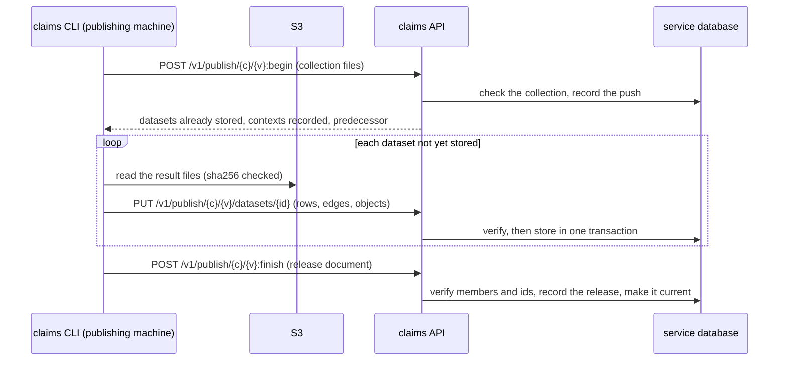

# Publishing to a deployed service

> **Status (2026-11-24): built.** `claims release publish ... --api qa` publishes a release into the
> deployed service with the token `claims login` saved ([CLI login](cli-login.md)), and the release
> records who published it. It works on QA once the service build with migration 011 is deployed there.
> `scripts/publish_collection.py` with the shared database password still works, and records no
> publisher.

The CLI already publishes a release into a *local* deployment: it reads the result files, checks them,
and derives the rows, edges and DAPPER objects that claims are rendered from. Publishing into the
deployed service does the same reading and checking on the publishing machine, then sends each dataset
to the API, which checks what it can recompute and stores it. Nothing needs the database password.

## Decisions

| Question | Decision (2026-11-24) |
| --- | --- |
| Where the files are read | On the publishing machine, which already has the S3 access and the disk. The QA task (0.25 vCPU, 512 MB, Spot, no S3 role) serves; it does not ingest. |
| Who may publish | Anyone with a valid `claims login` token, so the console's admins. Any collection, as decided for login; per-collection grants come later. |
| What is recorded | `published_by` (the token's email) and `publisher_token_id` on the release; who stored each dataset, for which collection (`publish_datasets`); and `release_publish_started` / `release_published` audit events. |
| What the API trusts | What it cannot recompute: the values read from the files (row values and their byte spans, edge ends), each result file's name, sha256, size and location, each run's description, and the provenance documents the release names. It computes everything else itself: every identifier, gene set, metric and mint context; the collection's own File records; each Dataset record; and the release and its publication Activity. |
| One write path | The API stores a dataset with the same function `scripts/publish_collection.py` uses against MySQL, so a pushed release and a directly published one are the same rows. |
| Unit of transfer | One dataset per request (gzip JSON, at most 16 MB compressed), stored in one transaction. Requests are idempotent, so a push that stops (network, a Spot replacement of the task) resumes by running the same command again. |
| A recorded version | Immutable, as today: pushing different content under a recorded version is refused. |
| QA and prod | Share the database. A release pushed to QA is served by prod as well. |
| Out of scope | Object collections (`kind: objects`), which publish through deposits with API keys; local deployments, which stay SQLite plus Parquet. |

## The flow

```text
server$ claims login                                         # once per 30 days
server$ claims release plan    $C 2026.12.0                  # as for a local deployment
server$ claims release publish $C 2026.12.0 --api qa --first 1     # one dataset; not served yet
server$ claims release publish $C 2026.12.0 --api qa --workers 4   # the rest; then the release is recorded
```

`--api` takes `qa` or a service's base URL; it is never a default. `--first`, `--workers` and resuming
work as they do locally, and the local deployment (`--db`, `--index-dir`) still keeps the sha256 cache
of the files read, but no rows. The release is recorded, and served, only when every dataset is in.



## API

Every route needs `Authorization: Bearer clp_...` (`require_publisher`).

| Route | Body | Answer |
| --- | --- | --- |
| `POST /v1/publish/{collection}/{version}:begin` | `files`: the collection's files (manifest, templates, queries, vocabulary files) by relative path; `prefix`: the collection directory's path in its git repository | `bundle` (the files' digest), `existing_release_id`, `existing_was_revision_of`, `current_release_id` |
| `POST /v1/publish/{collection}/{version}:check` | `datasets`, `contexts`: ids | which datasets are stored and which mint contexts recorded |
| `PUT /v1/publish/{collection}/{version}/datasets/{dataset_id}` | `bundle`; `dataset`: raw dimension values, File records by role, bounds, the run's id; `extract`: rows by kind and edges as values (none when the dataset is already stored) | the dataset's counts |
| `POST /v1/publish/{collection}/{version}:finish` | `bundle`; the release, its DAPPER document, provenance nodes it names, the provenance record, the code version | `release_id` |

Errors are 400 (the push is wrong: the message says what), 401 (no valid token), 409 (the version is
recorded with other content, a file is already another dataset's, the key is an object collection's,
or a record would differ from the one stored), 413 (too large), 503 (another request is storing the
same dataset or recording a release of the same collection). The CLI tries a 5xx or a dropped
connection again, up to six times over about three minutes; anything else stops the push with the
API's message.

Only one request stores a given dataset at a time, and only one records a release of a given collection
(MySQL named locks). A dataset request that outlives the load balancer's 60-second timeout keeps running
and commits. While it runs, a retry is answered 503 before its body is read, and before each retry the
CLI asks `:check` whether the dataset got stored, so it does not send it again.

## Checks the API makes

- **Collection.** The files load and validate as a file-based collection whose key is `{collection}` and
  is not an object collection's. Every file the manifest names must be one of the files sent: nothing
  outside them is read. They are stored once by digest (`publish_bundles`).
- **Dataset.** The API builds the Dataset and File records from the values sent (dimension values through
  the collection's own mappings, the bounds, each file's name, sha256, size and location) and refuses a
  dataset id they do not make. A file already stored as another dataset with the same dimension values is
  refused.
- **Rows.** Each kind is one of the manifest's row kinds, read from that kind's file; each row's
  dimension columns match the dataset; it is above the bounds; subjects are unique per kind; every
  metric is a finite number, and its byte span is exactly that value's text. Identifiers, labels,
  metrics and gene sets are computed by the API.
- **Mint contexts.** Computed by the API from the collection and the dataset.
- **Release.** The API builds the release record and its publication Activity itself and refuses any
  other. Its members must each be a dataset stored for this collection (`publish_datasets`, or a member
  of one of its recorded releases). It stores only the records a release carries: those it computes,
  each member's Dataset, result File and run records, and provenance nodes the release's provenance
  record names (never a class the service mints, such as a Claim or a GeneSet). Every edge in the
  document starts at one of them.

What the API cannot check is that the rows are what the files hold: it has no access to the files. Who
stored each dataset and who recorded the release are kept, and every claim's evidence still names its
file by sha256 and byte range, so the rows can be audited against the files later. A file's location is
the publisher's statement; its id covers its name, sha256 and size, not where it is.

## Measured (2026-11-24)

Three of the largest PIGEAN datasets of release 2026.11.2 (IBD, T2D, HEIGHT; 576,342 edges, 8,475 rows),
pushed from a laptop to the service running locally against a scratch database on the QA Aurora cluster:

| Request | Raw | Sent (gzip) | Time |
| --- | --- | --- | --- |
| Largest dataset (about 190,000 edges) | 23.8 MB | 4.5 MB | 50 s |
| Smallest of the three | 11.1 MB | 1.7 MB | 18 s |
| `:begin` (the collection's files) | 0.55 MB | 0.07 MB | 1 s |
| `:finish` | 0.02 MB | 0.01 MB | 2 s |

The service process peaked at about 300 MB. QA's largest dataset has 341,026 edges, and 62 datasets have
more than 100,000, so the QA task needs more than its 512 MB: the deploy that brings this sets
2 GB. The release's 22.8 million edges at the measured rate (about 6,000 edges a second over the internet;
faster inside AWS) come to roughly an hour, less with `--workers 4`.

The same release published directly and pushed (four workers in parallel, into MySQL) gave identical
rows, metrics, edges, objects, references, text index, mint contexts and release record
(`tests/test_publish_push.py` checks the same on SQLite, and that the served claims are identical).
