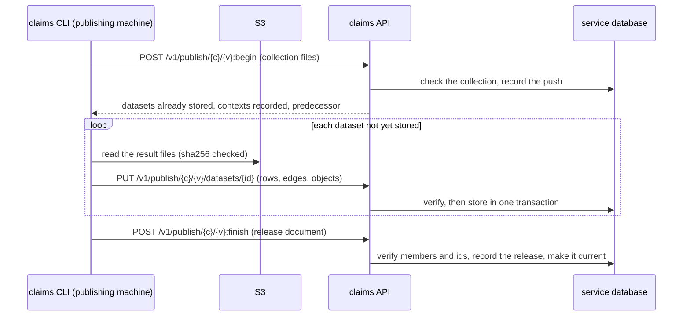

# Publishing to a deployed service

> **Status (2026-11-24): in development.** `claims release publish --api URL` publishes a release into
> the deployed service with the token `claims login` saved ([CLI login](cli-login.md)), and the release
> records who published it. Until it ships, publishing into QA is `scripts/publish_collection.py` with
> the shared database password.

The CLI already publishes a release into a *local* deployment: it reads the result files, checks them,
and derives the rows, edges and DAPPER objects that claims are rendered from. Publishing into the
deployed service does the same reading and checking on the publishing machine, then sends each dataset
to the API, which checks what it can recompute and stores it. Nothing needs the database password.

## Decisions

| Question | Decision (2026-11-24) |
| --- | --- |
| Where the files are read | On the publishing machine, which already has the S3 access and the disk. The QA task (0.25 vCPU, 512 MB, Spot, no S3 role) serves; it does not ingest. |
| Who may publish | Anyone with a valid `claims login` token, so the console's admins. Any collection, as decided for login; per-collection grants come later. |
| What is recorded | `published_by` (the token's email) and `publisher_token_id` on the release, and `release_publish_started` / `release_published` audit events. |
| What the API trusts | Only what it cannot recompute: row values, edges and gene-set members read from the files. It recomputes everything else: every object's id from its content, metrics from each row's values, mint contexts and the manifest, template and query records from the collection files sent with the push, each dataset's dimension values from the collection's mappings, and the release's members, predecessor and manifest. |
| One write path | The API stores a dataset with the same function `scripts/publish_collection.py` uses against MySQL, so a pushed release and a directly published one are the same rows. |
| Unit of transfer | One dataset per request (gzip JSON, at most 16 MB compressed), stored in one transaction. Requests are idempotent, so a push that stops (network, a Spot replacement of the task) resumes by running the same command again. |
| A recorded version | Immutable, as today: pushing different content under a recorded version is refused. |
| QA and prod | Share the database. A release pushed to QA is served by prod as well. |
| Out of scope | Object collections (`kind: objects`), which publish through deposits with API keys; local deployments, which stay SQLite plus Parquet. |

## The flow

```text
server$ claims login                                         # once per 30 days
server$ claims release plan    $C 2026.12.0                  # as for a local deployment
server$ claims release publish $C 2026.12.0 --api https://api-qa.hugeampkpnbi.org/api/claims --first 1
server$ claims release publish $C 2026.12.0 --api https://api-qa.hugeampkpnbi.org/api/claims --workers 4
```

`--first`, `--workers` and resuming work as they do locally. The release is recorded, and served, only
when every dataset is in.



## API

Every route needs `Authorization: Bearer clp_...` (`require_publisher`).

| Route | Body | Answer |
| --- | --- | --- |
| `POST /v1/publish/{collection}/{version}:begin` | The collection's files (manifest, templates, queries, vocabulary files) by relative path, and the code version | `bundle` (the files' digest), `existing_release_id`, `previous_release_id`, `stored_datasets`, `recorded_contexts` |
| `PUT /v1/publish/{collection}/{version}/datasets/{dataset_id}` | `bundle`; the dataset (its Dataset and File documents, raw dimension values, bounds); its rows by kind, edges and objects. Rows are left out when the dataset is already stored | the dataset's counts |
| `POST /v1/publish/{collection}/{version}:finish` | `bundle`; the release, its DAPPER document, its objects and the provenance record | `release_id` |

Errors are 400 (the push is wrong: the message says what), 401 (no valid token), 409 (the version is
recorded with other content, or a file is already another dataset's), 413 (too large).

## Checks the API makes

- **Collection.** The files load and validate as a collection whose key is `{collection}`; they are
  stored once by digest (`publish_bundles`).
- **Objects.** Every object's id is the DAPPER-ID-1 address of its content.
- **Dataset.** Its Dataset document lists exactly the File documents sent, under the manifest's roles;
  its dimension values are what the collection's mappings make of the raw values. A file already stored
  as another dataset with the same dimension values is refused.
- **Rows.** Each kind is one of the manifest's row kinds, read from that kind's file; subjects are
  unique per kind; every metric the manifest names is a finite number in the row's values. Metrics are
  computed by the API.
- **Mint contexts.** Computed by the API from the collection and the dataset.
- **Release.** Its collection key and version are the route's; its members are stored datasets of this
  push; its manifest, template and query files are those of the bundle; its predecessor is the version's
  existing predecessor or the collection's current release.

What the API cannot check is that the rows are what the files hold: it has no access to the files. The
publisher's identity is recorded with the release, and every claim's evidence still names its file by
sha256 and byte range, so the rows can be audited against the files later.

## Measured

To fill in from the first push: one PIGEAN dataset's request size and store time, and the estimate
for 1,444 datasets.
