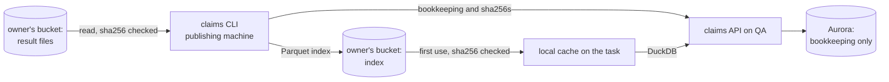

# Publishing to a deployed service

> **Status (2026-11-24): built, not yet on QA.** `claims release publish ... --api qa --index-to
> s3://bucket/prefix` publishes a release into the deployed service with the token `claims login` saved
> ([CLI login](cli-login.md)). The release's data stays in buckets: the result files where they are, and
> the release's query index next to them. The service database keeps only bookkeeping. It works on QA
> once migration 011 is applied and this build is deployed there.

## The architecture

The result files stay where their owner put them (S3). Claims cite them by sha256 and byte range, and
nothing copies them.

Queries need an index: scanning thousands of NDJSON files per query is not workable. The index is
Parquet, one small directory per dataset (rows, metrics, edges, counts), about 0.2 MB per PIGEAN trait
(9.1 MB for 50 traits; about 180 MB for the whole 1,444-trait run, against the 12 GB the same run
takes as MySQL rows today). The publishing machine builds it and puts it in a bucket the data's owner
keeps, next to the data.

The service (QA) is told where each dataset's index is and records its files' sha256, size and S3
version. It reads an index into a local cache the first time a query needs it, checks every file
against that record, and serves from the cache with DuckDB. A file changed in the bucket after publishing
is refused, not served.

What the service database keeps for such a release: the collection, release and dataset records, file
and mint-context records, the index locations (`dataset_indexes`), and the claims actually served
(`result_claims` and their objects, written the first time each is served). It keeps no result rows,
metrics or edges.



## Decisions

| Question | Decision (2026-11-24) |
| --- | --- |
| Where the data lives | The result files stay where they are; each release's Parquet index goes in a bucket the owner keeps. The service database holds no result rows. |
| How the service reads the index | Into a local cache on first use, checked against the sha256 recorded at publish, then DuckDB over the cache. Reading straight from S3 per query was measured and is too slow (below). |
| Which buckets the service reads | Those in `CLAIMS_INDEX_BUCKETS`, each also granted in the task's IAM policy. QA's test bucket is `cyaka-claims-index-test` (private, versioned; same account). An owner's bucket elsewhere needs a grant (or to be public). |
| Where the files are read | On the publishing machine, which has the S3 access and the disk. |
| Who may publish | Anyone with a valid `claims login` token, so the console's admins; any collection, for now. |
| What is recorded | `published_by` and `publisher_token_id` on the release; per dataset, who registered it for which collection and where its index is (`dataset_indexes`); `release_publish_started` / `release_published` audit events. |
| What the API trusts | Only the values read from the files (row values and their byte spans, edge ends) and each result file's name, sha256, size and location. Before recording a dataset it reads the index back and computes every identifier, gene set, metric and edge again from those values; any difference is refused. It also computes the Dataset, File, mint-context and release records itself. |
| A recorded version | Immutable: pushing different content under a recorded version is refused. |
| QA and prod | Share the database. A release pushed to QA is listed by prod too; prod serves it only once it runs this build and can read the bucket. Test with a test collection handle. |
| Object collections | Not pushed: an object collection (`kind: objects`) is registered and filled through deposits with the same login, `claims objects register` and `claims objects deposit` ([Depositing objects](depositing-objects.md)). |
| Out of scope | Releases already in MySQL (the current `pigean`) keep being served from MySQL. |

## The flow

```text
server$ claims login                                                  # once per 30 days
server$ claims release plan    $C 2026.12.0                           # as for a local deployment
server$ claims release publish $C 2026.12.0 --api qa \
          --index-to s3://<owner bucket>/<prefix> --first 1           # one dataset; not served yet
server$ claims release publish $C 2026.12.0 --api qa \
          --index-to s3://<owner bucket>/<prefix> --workers 4         # the rest; then the release is recorded
```

`--api` takes `qa` or a service's base URL, and `--index-to` is required with it; neither is ever a
default. `--first`, `--workers` and resuming work as they do locally. The local deployment (`--db`,
`--index-dir`) keeps the sha256 cache of the files read and stages each index before upload. The
release is recorded, and served, only when every dataset is in.

## API

Every route needs `Authorization: Bearer clp_...` (`require_publisher`).

| Route | Body | Answer |
| --- | --- | --- |
| `POST /v1/publish/{collection}/{version}:begin` | `files`: the collection's files (manifest, templates, queries, vocabulary files) by relative path; `prefix`: the collection directory's path in its git repository; `index_location`: `s3://bucket/prefix` | `bundle` (the files' digest), `existing_release_id`, `existing_was_revision_of`, `current_release_id` |
| `POST /v1/publish/{collection}/{version}:check` | `datasets`, `contexts`: ids | which datasets are stored and which mint contexts recorded |
| `PUT /v1/publish/{collection}/{version}/datasets/{dataset_id}` | `bundle`; `dataset`: raw dimension values, File records by role, bounds, the run's id; `index`: `{location, files: {name: {sha256, size, version_id}}}` (none when the dataset is already stored) | the dataset's counts |
| `POST /v1/publish/{collection}/{version}:finish` | `bundle`; the release, its DAPPER document, provenance nodes it names, the provenance record, the code version | `release_id` |

A dataset's index is at `<index_location>/datasets/<dataset id>/` (the service derives the path).
Errors are 400 (the push is wrong: the message says what), 401 (no valid token), 409 (the version is
recorded with other content, a file is already another dataset's, the key is an object collection's,
or a record would differ from the one stored), 413 (too large), 503 (another request is storing the
same dataset or recording a release of the same collection). The CLI tries a 5xx or a dropped
connection again, and before each retry of a dataset asks `:check` whether it got stored.

## Checks the API makes

- **Collection.** The files load and validate as a file-based collection whose key is `{collection}` and
  is not an object collection's. Every file the manifest names must be one of the files sent: nothing
  outside them is read. They are stored once by digest (`publish_bundles`).
- **Index location.** `s3://bucket/prefix`, strictly formed, in a bucket of `CLAIMS_INDEX_BUCKETS`.
- **Dataset.** The API builds the Dataset and File records from the values sent and refuses a dataset id
  they do not make. A result file already stored as another dataset with the same dimensions is refused.
- **Index.** Each file's sha256 and size must match; then rows, metrics and edges are recomputed from the
  index's values (dimension columns, bounds, unique subjects, finite metrics, byte spans that are exactly
  each value's text) and must equal the index.
- **Mint contexts.** Computed by the API from the collection and the dataset.
- **Release.** The API builds the release record and its publication Activity itself and refuses any
  other. Its members must each be a dataset stored for this collection. It stores only the records a
  release carries.

What the API cannot check is that the values are what the result files hold: it does not read them. Who
registered each dataset is kept, and every claim's evidence names its file by sha256 and byte range, so
the index can be audited against the files later.

## Measured (2026-11-24)

**The index.** 50 PIGEAN traits of release 2026.11.2 (including IBD, T2D and HEIGHT; 23,732 rows,
1,154,276 edges): 9.1 MB of Parquet, built in 4 minutes from S3 on a laptop.

**Serving straight from S3** (DuckDB over the index in S3, from a laptop): correct claims, but 8 to 94 s
a query against 0.04 to 0.6 s from local files. A query makes about 90 small reads of the store, each a
round trip to S3; DuckDB's object and metadata caches did not change that. Hence the local cache.
